# Toolib 🧰

> A curated personal library of cool websites and tools worth bookmarking.

📚 **21 tools** · 🗓️ **Last updated:** November 2026

---

## Introduction

**Toolib** is a growing collection of websites, web apps, and online tools that I've found genuinely useful, impressive, or just plain fun. Each entry includes a short description, a link to the live tool, and source code where available.

This repo is for personal reference and discovery — think of it as a living bookmarks bar, but organized and shareable. It's also a small way to give these tools the visibility they deserve: if you find something you like here, go support its creators.

Toolib is a non-commercial project. It isn't monetized in any way, and it never will be.

> ⚠️ This file is auto-generated from `tools_db.yml`. Don't edit it directly.

---

## Contents

- [Design & Creative](#design--creative) (3)
- [Developer Tools](#developer-tools) (9)
- [Games & Tabletop](#games--tabletop) (1)
- [Music & Audio](#music--audio) (1)
- [Productivity & Practice](#productivity--practice) (2)
- [Reference & Research](#reference--research) (5)

---

## Library

### Design & Creative

---

#### Excalidraw

    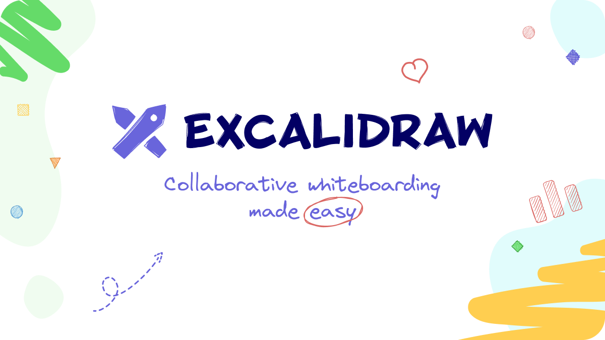

| | |
|---|---|
| **URL** | [excalidraw.com](https://excalidraw.com) |
| **Source** | [github.com/excalidraw/excalidraw](https://github.com/excalidraw/excalidraw) |

A free, open-source virtual whiteboard for sketching diagrams, wireframes, and flowcharts with a distinctive hand-drawn look. Runs entirely in the browser with no sign-up, offers end-to-end encrypted live collaboration, reusable shape libraries, and export to PNG, SVG, or the clipboard. Also available as an embeddable React component.

---

#### FigCraft

    

| | |
|---|---|
| **URL** | [getartcraft.com/apps/figcraft](https://getartcraft.com/apps/figcraft) |
| **Source** | [github.com/storytold/figcraft](https://github.com/storytold/figcraft) |

A free, open-source interface design and prototyping app built in pure Rust, part of the ArtCraft suite. Offers frames with auto layout, components and variants, vector networks, variables with light/dark modes, and interactive prototypes, plus a Dev Mode that generates CSS, HTML, React, SwiftUI, and Compose code. Runs natively offline on macOS, Windows, and Linux or in the browser, with real-time collaboration and no account required.

---

#### TerraInk

    

| | |
|---|---|
| **URL** | [terraink.app](https://terraink.app) |
| **Source** | [github.com/yousifamanuel/terraink](https://github.com/yousifamanuel/terraink) |

A free, open-source cartographic poster engine that turns any location in the world into a beautifully styled map poster — entirely in your browser. Powered by real OpenStreetMap data, with rich theme customization, layer controls, custom typography, and high-resolution PNG/PDF export.

---

### Developer Tools

---

#### Bruno

    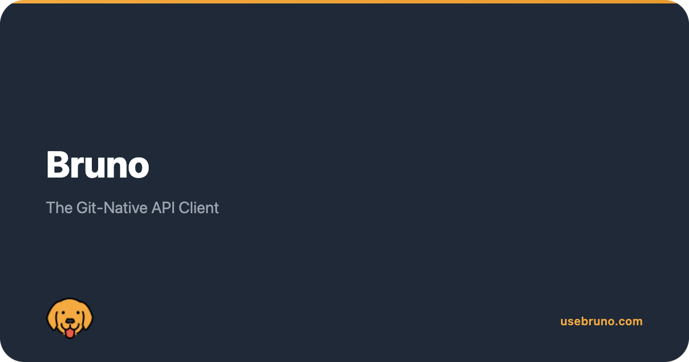

| | |
|---|---|
| **URL** | [www.usebruno.com](https://www.usebruno.com) |
| **Source** | [github.com/usebruno/bruno](https://github.com/usebruno/bruno) |

An open-source, offline-first API client and Git-friendly alternative to Postman. Supports REST, GraphQL, gRPC, and WebSocket requests, and stores collections as plain-text files on your filesystem so they can be versioned and reviewed alongside your code. Includes environments, pre/post-request scripting, assertions and tests, and a CLI for running collections in CI. No cloud sync or account required.

---

#### Bundlephobia

    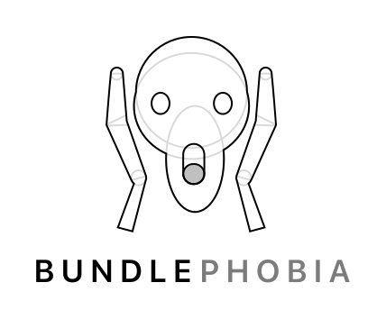

| | |
|---|---|
| **URL** | [bundlephobia.com](https://bundlephobia.com) |
| **Source** | [github.com/pastelsky/bundlephobia](https://github.com/pastelsky/bundlephobia) |

A free, open-source tool for finding the cost of adding an npm package to your frontend bundle. Look up any package to see its minified and gzipped size, estimated download time on slow networks, and which dependencies make up its weight. Compare sizes across versions, check exports for tree- shaking, scan a whole package.json, and discover lighter alternatives.

---

#### Can I email

    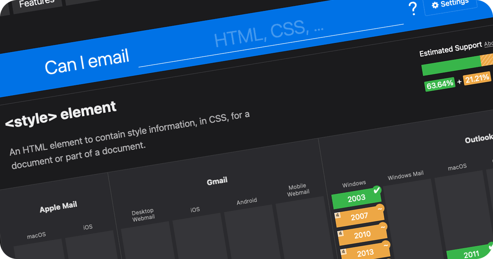

| | |
|---|---|
| **URL** | [www.caniemail.com](https://www.caniemail.com) |
| **Source** | [github.com/hteumeuleu/caniemail](https://github.com/hteumeuleu/caniemail) |

Support tables for HTML and CSS in emails, in the spirit of Can I use. Look up an HTML element, CSS property, or image format to see whether it works in Gmail, Outlook, Apple Mail, and many other clients across webmail, desktop, and mobile. Includes a scoreboard ranking clients by overall support, and the community-maintained data is open source and available as JSON.

---

#### Carbon

    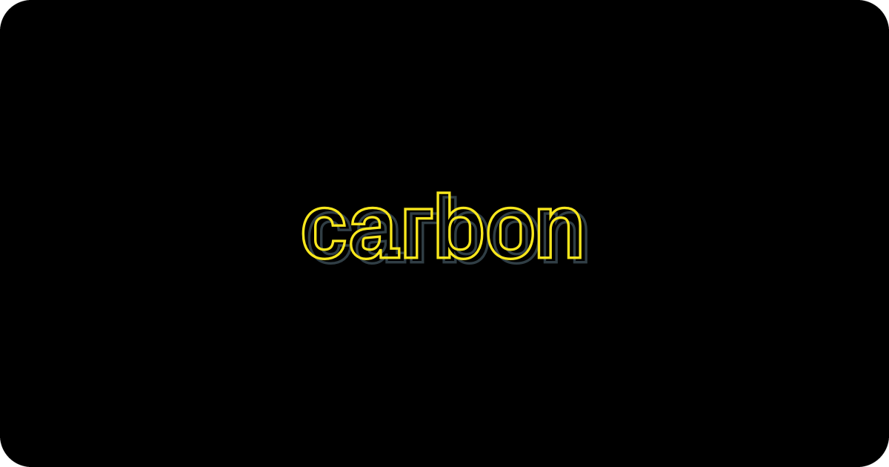

| | |
|---|---|
| **URL** | [carbon.now.sh](https://carbon.now.sh) |
| **Source** | [github.com/carbon-app/carbon](https://github.com/carbon-app/carbon) |

A free, open-source tool for creating and sharing beautiful images of your source code. Paste a snippet or import a GitHub gist, then customize the syntax theme, font, background, padding, and window style. Export as PNG or SVG, copy straight to the clipboard, or share a link or embed. Community plugins bring it into editors like IntelliJ IDEA and Xcode.

---

#### Crontab Guru

    

| | |
|---|---|
| **URL** | [crontab.guru](https://crontab.guru) |
| **Source** | *(closed source)* |

A quick and simple editor for cron schedule expressions, made by Cronitor. Type an expression and it is instantly translated into plain English, with the next scheduled run times and a reference for each field's allowed values and special characters. Includes a library of common cron examples to copy from.

---

#### cssdb

    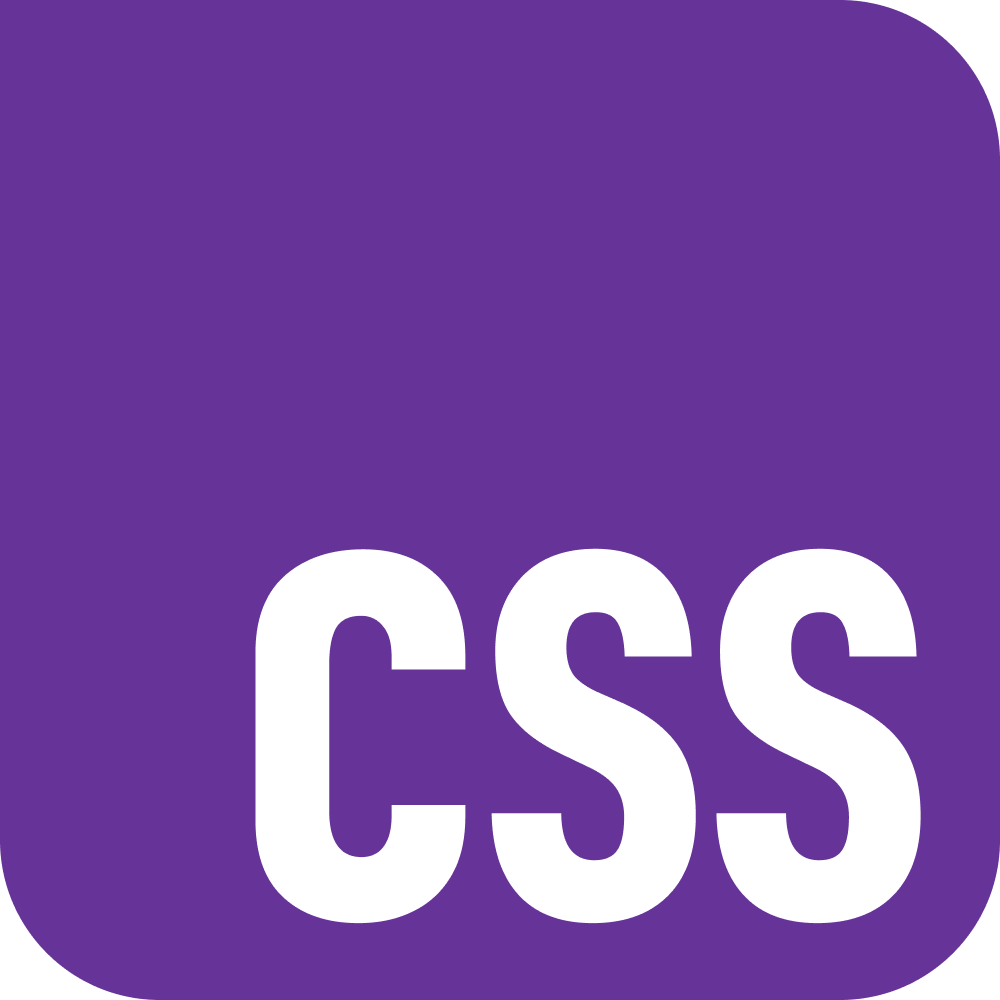

| | |
|---|---|
| **URL** | [cssdb.org](https://cssdb.org) |
| **Source** | [github.com/csstools/cssdb](https://github.com/csstools/cssdb) |

A database of CSS features tracked by how far they are in the process of becoming web standards, maintained by CSSTools. Each feature gets a stage, a short description, example code, browser support from MDN's compatibility data, and links to the docs and spec. Also lists the PostCSS plugins and polyfills that let you use a feature today, and which of them ship with postcss-preset-env.

---

#### Localtunnel

    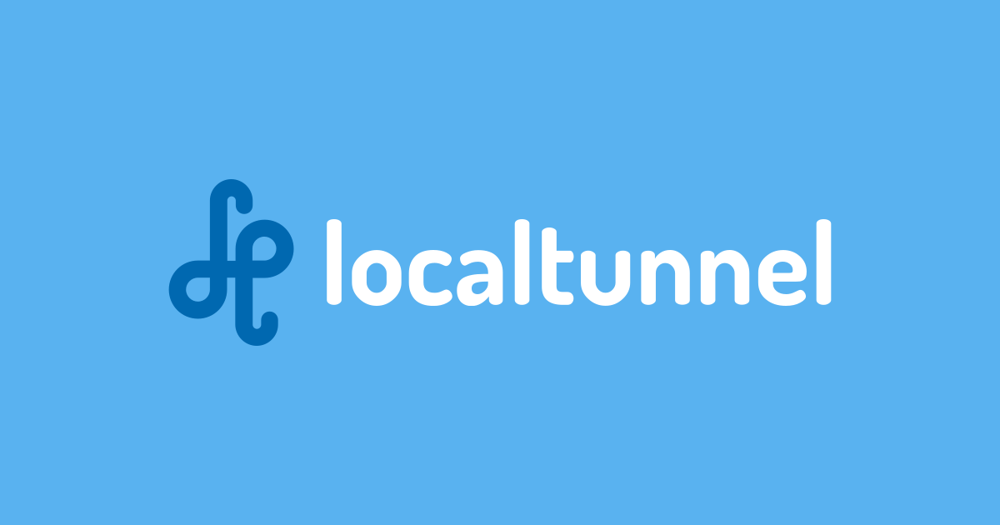

| | |
|---|---|
| **URL** | [localtunnel.me](https://localtunnel.me) |
| **Source** | [github.com/localtunnel/localtunnel](https://github.com/localtunnel/localtunnel) |

A free, open-source tool that exposes a web server running on your machine through a public HTTPS URL, with no DNS or firewall changes. Install it with npm and run lt with your local port to get a shareable link that stays up while the process runs. Handy for sharing work in progress, testing webhooks against your local API, or checking your UI in cloud browsers.

---

#### Regex101

    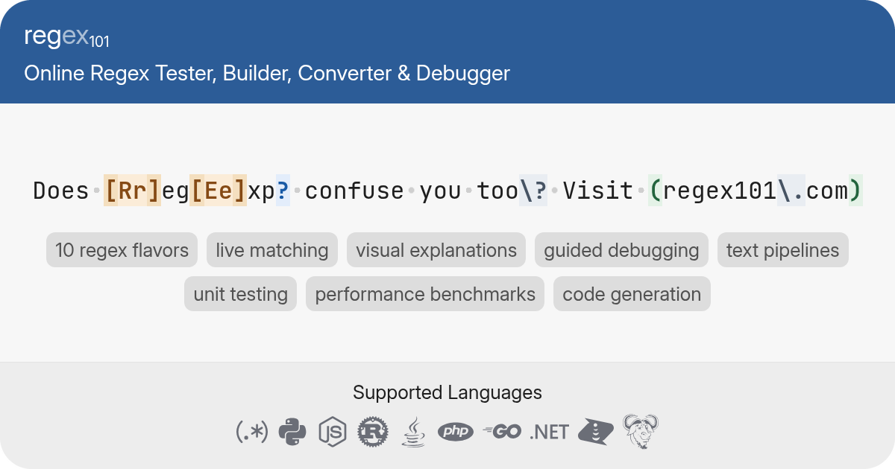

| | |
|---|---|
| **URL** | [regex101.com](https://regex101.com) |
| **Source** | *(closed source)* |

The gold standard online regex tester and debugger. Supports PCRE, Python, JavaScript, Go, Java, C#/.NET, and Rust. Features live syntax highlighting, automatic step-by-step explanation, a cheat sheet, community pattern library, debugger, unit test runner, and a code generator.

---

#### tweakcn

    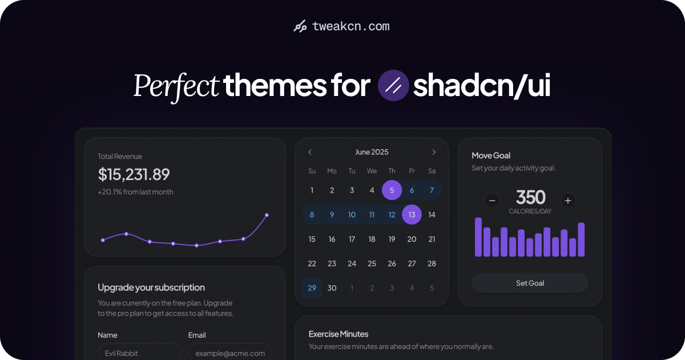

| | |
|---|---|
| **URL** | [tweakcn.com](https://tweakcn.com) |
| **Source** | [github.com/jnsahaj/tweakcn](https://github.com/jnsahaj/tweakcn) |

A free, open-source visual theme editor for shadcn/ui and Tailwind CSS. Start from a gallery of theme presets or build your own by tweaking colors, typography, and other style properties, with a live preview of real components as you go. Copy the generated theme code straight into your project, so your shadcn/ui app doesn't look like every other one.

---

### Games & Tabletop

---

#### Dungeon Scrawl

    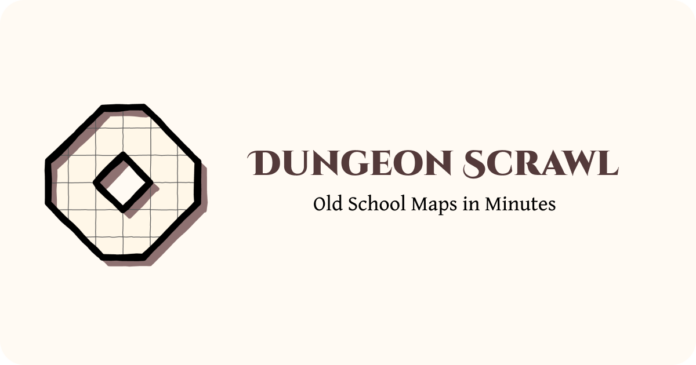

| | |
|---|---|
| **URL** | [www.dungeonscrawl.com](https://www.dungeonscrawl.com) |
| **Source** | *(closed source)* |

A free, browser-based dungeon and battlemap maker for tabletop RPGs like D&D and Pathfinder. Build rooms, halls, and scenes in minutes — no downloads or sign-up required. Supports multiple map styles, custom assets, PNG/SVG/PDF export, and direct Roll20 integration.

---

### Music & Audio

---

#### MuseScore

    

| | |
|---|---|
| **URL** | [musescore.org/en](https://musescore.org/en) |
| **Source** | [github.com/musescore/MuseScore](https://github.com/musescore/MuseScore) |

A free, open-source WYSIWYG music notation editor for composing, arranging, and printing sheet music. Supports a wide range of formats including MusicXML, MIDI, and PDF export, with integrated audio playback for real-time score preview.

---

### Productivity & Practice

---

#### MonitorControl

    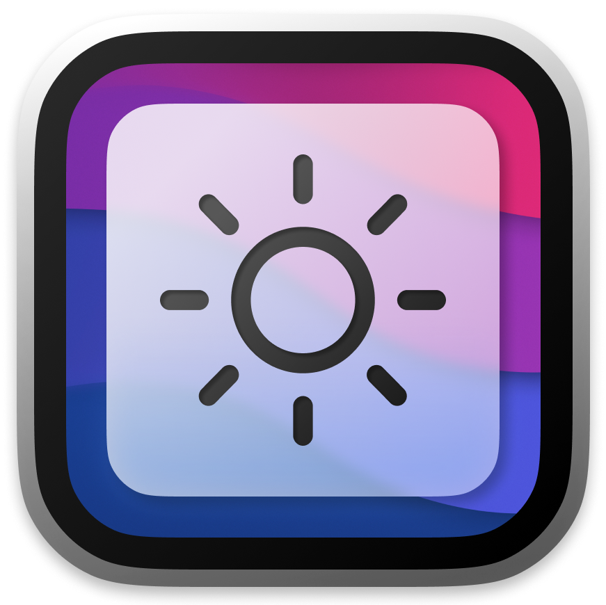

| | |
|---|---|
| **URL** | [github.com/MonitorControl/MonitorControl](https://github.com/MonitorControl/MonitorControl) |
| **Source** | [github.com/MonitorControl/MonitorControl](https://github.com/MonitorControl/MonitorControl) |

A free, open-source macOS menu bar app that controls the brightness, contrast, and volume of external displays as if they were native Apple displays. Works with Apple keyboard brightness and media keys or custom shortcuts and shows the native macOS on-screen indicators. Combines DDC hardware control with software dimming, and can sync brightness across all your screens.

---

#### Monkeytype

    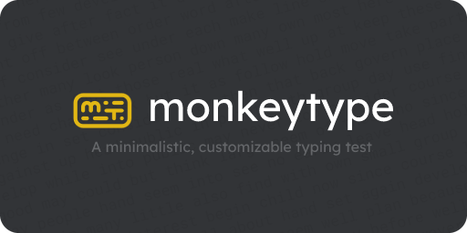

| | |
|---|---|
| **URL** | [monkeytype.com](https://monkeytype.com) |
| **Source** | [github.com/monkeytypegame/monkeytype](https://github.com/monkeytypegame/monkeytype) |

A minimalistic, highly customizable typing speed test. Features multiple test modes (timed, word count, quotes, custom), real-time WPM and accuracy tracking, themes, smooth caret animations, and an account system to track your progress over time.

---

### Reference & Research

---

#### Auto Catalog Archive

    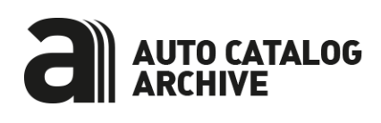

| | |
|---|---|
| **URL** | [autocatalogarchive.com](https://autocatalogarchive.com) |
| **Source** | *(closed source)* |

A massive digital archive of vintage automobile brochures and catalogs from manufacturers around the world. Explore high-quality scans of classic car marketing materials spanning decades, perfect for research, design inspiration, or nostalgic deep dives into automotive history.

---

#### Dimensions

    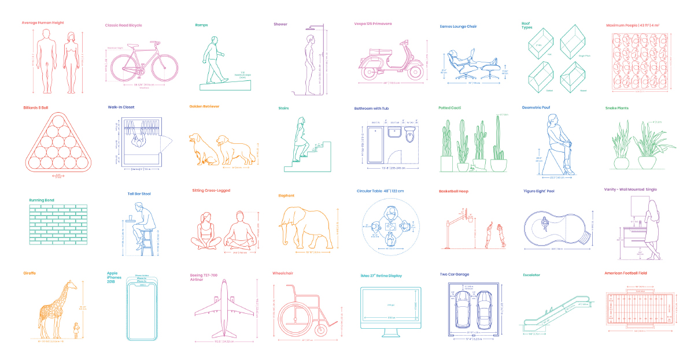

| | |
|---|---|
| **URL** | [www.dimensions.com](https://www.dimensions.com) |
| **Source** | *(closed source)* |

Dimensions.com is an ongoing reference database of dimensioned drawings documenting the standard measurements and sizes of the everyday objects and spaces that make up our world. Created as a universal resource to better communicate the basic properties, systems, and logics of our built environment, Dimensions.com is a global platform for increasing public and professional knowledge of life and design.

---

#### Movie Scene Map

    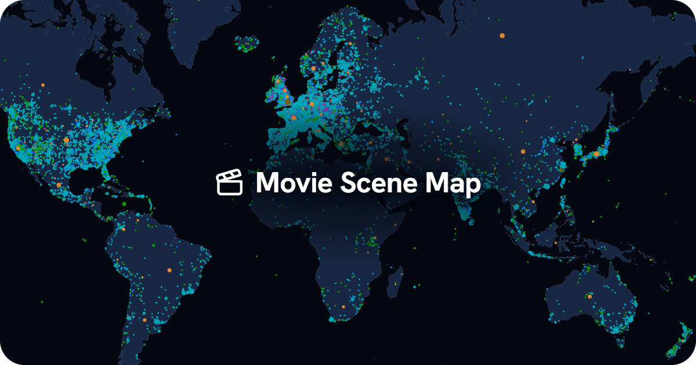

| | |
|---|---|
| **URL** | [moviescenemap.com](https://moviescenemap.com) |
| **Source** | *(closed source)* |

A free interactive world map of real filming locations for movies and TV series, plus the real-world settings of video games, anime, and manga. Search a title to see where it was shot, or a place to see what was filmed there, with photos and Wikipedia links for each location. Sourced from Wikidata and film archives, with the full dataset downloadable as CC0 GeoJSON or CSV.

---

#### SaaS is Dead

    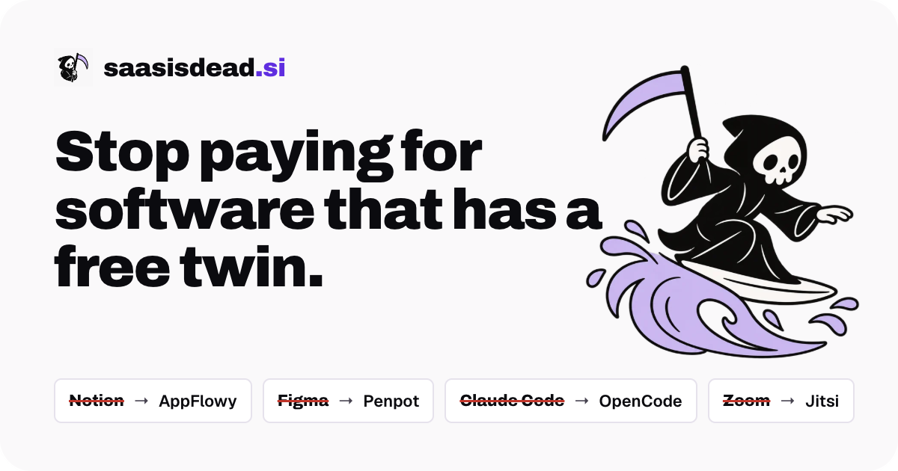

| | |
|---|---|
| **URL** | [saasisdead.si](https://saasisdead.si) |
| **Source** | [github.com/tonyzedginidze/saasisdead](https://github.com/tonyzedginidze/saasisdead) |

A searchable directory of open-source alternatives to the paid software you subscribe to. Commercial products are organized by category, from developer tools to design and email marketing, each paired with its list price and open-source replacements with live GitHub stats. New projects can be suggested or submitted via GitHub.

---

#### The Component Gallery

    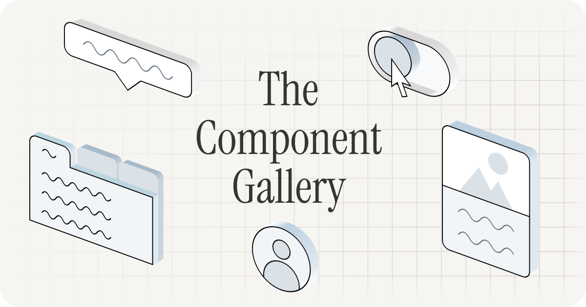

| | |
|---|---|
| **URL** | [component.gallery](https://component.gallery) |
| **Source** | [github.com/inbn/component-gallery](https://github.com/inbn/component-gallery) |

A reference of user interface components collected from real-world design systems. Each component, from accordions to tooltips, gets a description, its common alternative names, and links to how dozens of design systems implement it. Design systems are tagged by tech stack and by features like code examples, accessibility guidance, and open-source availability, making it easy to compare approaches before building your own.

---

## License

Toolib is released under the [MIT License](LICENSE) — use it, fork it, and rework it however you like.

The license covers this repository's code and text. The listed tools, their names, logos, and thumbnail images belong to their respective owners.
